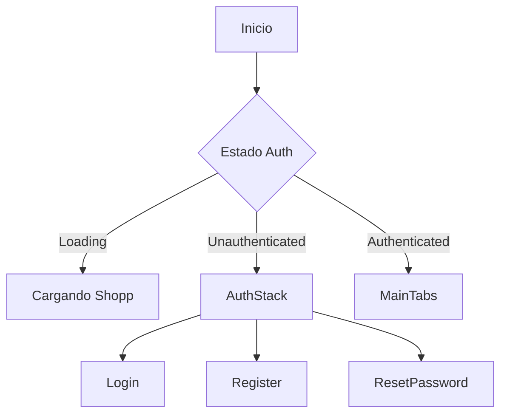
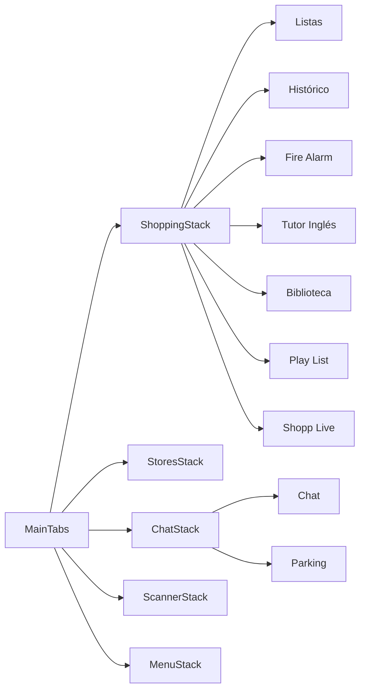
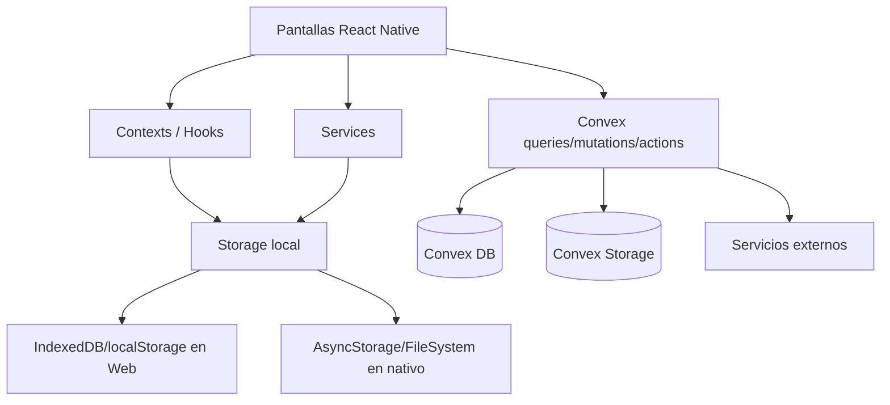
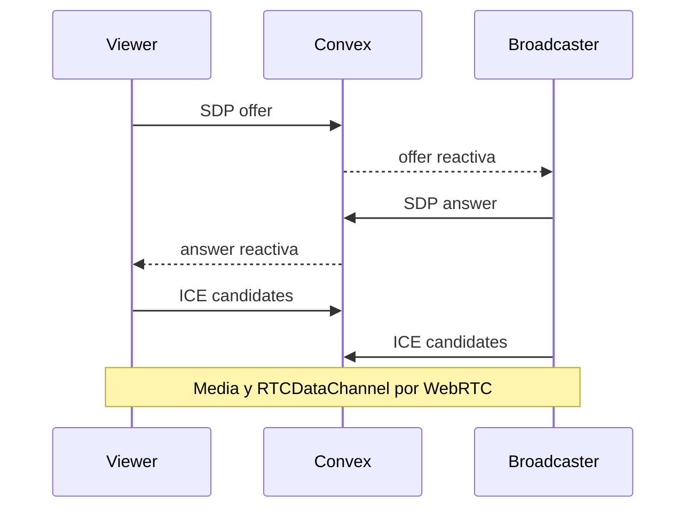
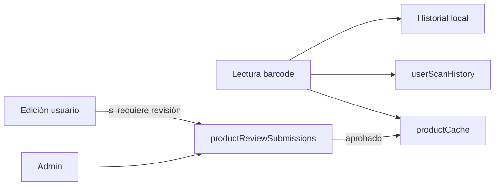
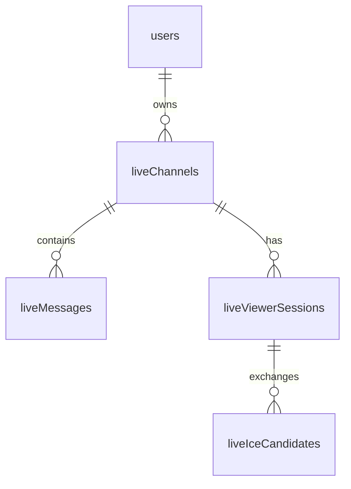

# Arquitectura de Shopp

> **Estado documental:** consolidación del ZIP `md(1).zip` (29-10-2026). La documentación técnica base fue elaborada en revisiones anteriores (principalmente septiembre de 2026); **no implica una auditoría del código vigente**. Revisar rutas, versiones y comportamiento contra el repositorio antes de aplicar cambios.

## Arquitectura

## 1. Entrada de la aplicación

`App.js` construye la raíz de Shopp:

```text
I18nProvider
└── SafeAreaProvider
    └── ConvexAuthProvider
        └── ListsProvider
            └── StoresProvider
                └── LocationProvider
                    ├── NavigationContainer
                    │   └── AppNavigator
                    └── DialogHost (solo Web)
```

El cliente Convex se instancia con:

```js
new ConvexReactClient(process.env.EXPO_PUBLIC_CONVEX_URL)
```

Por tanto, `EXPO_PUBLIC_CONVEX_URL` es una configuración **pública de frontend**, no un secreto.

## 2. Flujo de autenticación

`AppNavigator` usa los componentes de `@convex-dev/auth/react`:



En el backend, `convex/auth.js` usa `Password` y dos proveedores Resend OTP:

- `ResendOTPEmailVerification`;
- `ResendOTPPasswordReset`.

Al crear/actualizar un usuario, si no tiene rol se asigna `user`.

## 3. Navegación autenticada



La navegación está centralizada en `src/navigation/ROUTES.js`.

## 4. Arquitectura de datos

Shopp mezcla persistencia local y remota.



### Estado local

La carpeta `src/storage/` abstrae diferencias de plataforma. Entre las claves canónicas se encuentran:

- `@shopping/lists`
- `@shopping/history`
- `@shopping/purchases`
- `@shopping/scanned-items`
- `@shopping/stores`
- `@shopping/favorite-stores`
- `@shopping/barcode-settings`
- `@shopping/language`
- cachés de ubicación y distancia.

Existe además `getUserScopedStorageKey()` para aislar datos por usuario.

### Estado remoto

Convex mantiene dominios como:

- usuarios/perfiles;
- productos/caché/revisiones;
- historial sincronizado de escaneos;
- chat;
- Biblioteca;
- parking;
- tiendas/favoritos;
- playlists;
- Fire Alarm;
- Shopp Live.

## 5. Backend Convex

Cada fichero en `convex/` agrupa queries, mutations, actions o tareas internas por dominio.

Patrones relevantes:

- `getAuthUserId(ctx)` para obtener identidad;
- `requireUser(ctx)` / `requireAdmin(ctx)` en `convex/lib/auth.js`;
- índices explícitos para consultas frecuentes;
- `ctx.storage` para ficheros;
- `crons.js` para limpieza periódica.

## 6. Cron jobs

El repositorio configura actualmente:

- limpieza horaria de adjuntos temporales de denuncias;
- limpieza cada 6 horas de imágenes temporales de productos;
- limpieza horaria de mensajes de chat caducados.

Los jobs invocan funciones `internal` de Convex.

## 7. Biblioteca e importaciones largas

`src/screens/library/LibraryScreen.js` implementa una estrategia específica para importaciones grandes:

- lotes de lectura/escritura;
- persistencia temporal del payload;
- `libraryImportJobs` en Convex para registrar progreso;
- IndexedDB en web;
- `expo-file-system` en nativo;
- reintentos con backoff;
- modo `combine` o `replace`;
- fases separadas para enlaces y fuentes.

Esto evita depender de una única operación larga y reduce el riesgo de perder progreso ante recargas/interrupciones.

## 8. WebRTC: plano de control vs plano de media

### Shopp Live

- Convex almacena canal, sesiones, offer/answer e ICE candidates.
- `RTCPeerConnection` transporta audio/vídeo.
- `RTCDataChannel` transporta datos P2P.
- El broadcaster usa actualmente STUN público de Google.

### Fire Alarm

- Convex almacena la alarma y mensajes de señalización.
- El vídeo no pasa por Convex.
- ICE usa STUN y puede añadir TURN si se configuran variables específicas.



## 9. PWA

La exportación web usa Metro y `web.output = "single"`.

Elementos principales:

- `public/manifest.webmanifest`;
- `public/sw.js`;
- `public/_redirects`;
- redirección Netlify `/* -> /index.html`.

El service worker aporta caché del shell, pero no convierte la base remota de Convex en un datastore offline completo.


---

## Modelo de datos Convex

Fuente canónica: `convex/schema.js` del repositorio analizado.

## 1. Identidad

| Tabla | Propósito | Claves/índices relevantes |
|---|---|---|
| `users` | Tabla de Convex Auth ampliada con `role`. | `email` |
| `userProfiles` | Alias, avatar, teléfono y preferencias. | `by_userId`, `by_alias`, `by_phone` |

El rol admitido por schema es `user` o `admin`.

## 2. Productos y scanner

| Tabla | Propósito |
|---|---|
| `products` | Catálogo base por barcode. |
| `productContributions` | Aportaciones de producto con snapshot y consentimiento. |
| `userScanHistory` | Historial de escaneo por usuario, rico y sincronizable. |
| `temporaryProductImages` | Pareja detail/thumbnail temporal por usuario y barcode. |
| `scanHistory` | Historial/caché más simple por barcode. |
| `barcodeScans` | Evento de lectura con consentimiento explícito. |
| `productCache` | Caché compartida, estado y control de reintentos externos. |
| `productReviewSubmissions` | Cambios remitidos a revisión administrativa. |
| `shoppingItemsImport` | Staging/importación de items locales a Convex. |

### Flujo recomendado de interpretación



No todas las ramas se ejecutan necesariamente en cada escaneo; dependen del flujo de UI y permisos.

## 3. Chat y Biblioteca

| Tabla | Propósito |
|---|---|
| `chatMessages` | Mensajes, multimedia, producto, YouTube y seguridad URL. |
| `computerLinkFolders` | Carpetas jerárquicas de Biblioteca. |
| `computerLinks` | Enlaces de Biblioteca/noticias/fuentes/libros. |
| `libraryImportJobs` | Progreso reanudable de importaciones grandes. |

### `computerLinks.linkType`

```text
general
newsSource
newsArticle
bookStore
bookLink
```

### `computerLinks.status`

```text
pending
reviewed
archived
```

## 4. Comunicaciones con administración

| Tabla | Propósito |
|---|---|
| `rightsReportAttachments` | Adjuntos temporales enviados a administración. |

Los comentarios de schema indican que estos adjuntos se eliminan del storage después del envío y existe además limpieza de expirados por cron.

## 5. Fire Alarm

| Tabla | Propósito |
|---|---|
| `fireAlarms` | Alarma, propietario, estado, snapshot y administración. |
| `fireAlarmSignals` | Offer/answer/ICE de señalización WebRTC. |

Estados de alarma:

```text
pending -> acknowledged -> resolved
     \-> cancelled
```

## 6. Parking

| Tabla | Propósito |
|---|---|
| `parkingPresence` | Presencia/estado actual por usuario y zona. |
| `parkingDestinations` | Destinos permanentes. |
| `parkingGpsMeasurements` | Medidas GPS administrativas. |
| `parkingSpots` | Plazas/eventos georreferenciados. |
| `parkingWatchers` | Observadores interesados en una zona/plaza. |
| `parkingNotifications` | Notificaciones generadas por Parking. |
| `parkingAreaStats` | Contadores agregados por área. |
| `parkingMessages` | Mensajes/eventos de estado de Parking. |

### Estados detectados

Presencia:

```text
heading | looking | parked | leaving | offline
```

Plaza:

```text
free | occupied | leaving | unknown | expired
```

Mensajes/estado funcional:

```text
looking | parked | leaving
```

Schema conserva además valores legacy de chat en determinados campos para compatibilidad.

## 7. Tiendas

| Tabla | Propósito |
|---|---|
| `stores` | Catálogo global de tiendas. |
| `userStoreFavorites` | Relación usuario-tienda favorita. |

**Importante:** el campo `stores.favorite` está documentado como heredado. La preferencia personal debe modelarse con `userStoreFavorites`.

## 8. Playlists

| Tabla | Propósito |
|---|---|
| `youtubePlaylists` | Playlists por propietario con array de tracks y letras opcionales. |

## 9. Shopp Live

| Tabla | Propósito |
|---|---|
| `liveChannels` | Metadatos y estado de cada canal. |
| `liveMessages` | Chat del canal Live. |
| `liveViewerSessions` | Señalización por viewer: offer/answer/estado. |
| `liveIceCandidates` | ICE candidate por sesión y lado. |

### Relaciones



## 10. Ownership y seguridad

El schema por sí solo no aplica ACLs. La protección depende de las funciones de `convex/*.js`.

Patrones existentes:

- funciones que derivan usuario desde Convex Auth;
- validación de propietario;
- `requireAdmin` para tareas administrativas;
- índices por `userId`, `ownerId`, `submittedBy`, etc.

Cuando se añada una nueva query/mutation, debe definirse explícitamente:

1. quién puede leer;
2. quién puede escribir;
3. quién puede borrar;
4. si un admin puede actuar sobre datos de terceros;
5. si el dato debe caducar o conservarse.


---

## Mapa del repositorio

## Raíz

| Ruta | Uso |
|---|---|
| `App.js` | Proveedores globales, Convex Auth y navegación. |
| `index.js` | Entrada Expo/React Native. |
| `package.json` | Dependencias y scripts. |
| `app.json` | Configuración Expo/iOS/Android/Web. |
| `eas.json` | Perfiles EAS Build. |
| `netlify.toml` | Build, headers y redirects de Netlify. |
| `.env.example` | Variables de ejemplo. |
| `metro.config.js` | Configuración Metro. |
| `jsconfig.json` / `tsconfig.json` | Resolución/aliases y TypeScript tooling. |
| `public/` | Assets/configuración de PWA. |
| `tests/` | Tests Node. |

## `src/`

### `src/navigation/`

- `AppNavigator.js`: auth vs app autenticada.
- `MainTabs.js`: tabs principales.
- `ShoppingStack.js`
- `StoresStack.js`
- `ChatStack.js`
- `ScannerStack.js`
- `MenuStack.js`
- `ROUTES.js`: nombres de rutas.

### `src/screens/`

| Directorio | Dominio |
|---|---|
| `admin/` | Usuarios y revisión de productos. |
| `auth/` | Login, registro y reset. |
| `chat/` | Chat, tutor, noticias y pantallas históricas. |
| `history/` | Histórico de compras. |
| `library/` | Biblioteca de enlaces. |
| `lists/` | Listas e items de compra. |
| `live/` | Shopp Live / WebRTC. |
| `parking/` | Parking y GPS. |
| `playlist/` | Play List. |
| `profile/` | Perfil/avatar. |
| `scanner/` | Escaneo, edición e historial. |
| `settings/` | Menú y configuración. |
| `stores/` | Tiendas. |
| `system/` | Splash. |
| `webRtcFireAlarm/` | Fire Alarm. |

### `src/components/`

Componentes reutilizables. Destacan familias para:

- chat y previews web;
- scanner;
- tiendas;
- diálogos seguros;
- controles UI.

### `src/context/`

- `ListsContext`
- `StoresContext`
- `LocationContext`
- `PurchasesContext`
- `ConfigContext`
- contexts de aprendizaje/sugerencias de producto.

### `src/hooks/`

Hooks para lookup de productos, historial de escaneos, sincronización y distancias.

### `src/services/`

| Fichero | Responsabilidad aproximada |
|---|---|
| `backupZip.js` | Backup/restauración ZIP local. |
| `exportUserData.js` | Export JSON. |
| `productLookup.js` | Lookup de producto. |
| `productSearchEngines.js` | Motores de búsqueda. |
| `scannerHistory.js` | Historial local. |
| `scannedHistorySync.js` | Merge/migración local-remoto. |
| `temporaryProductImageSync.js` | Imágenes temporales a Convex. |
| `urlSafety.js` | Seguridad/normalización URL. |

### `src/storage/`

Abstracción de persistencia con variantes web/nativas:

- `storage.web.js`
- `storage.native.js`
- `indexedDbStorage.web.js`
- claves y adaptadores específicos.

### `src/utils/`

Normalización, códigos, imágenes, categorías, validación, URLs, ZIP y utilidades generales.

### `src/constants/`

Configuración centralizada como:

- formatos de barcode;
- categorías;
- tipos de producto;
- motores de búsqueda;
- unidades;
- tiendas;
- prompts de lookup.

## `convex/`

| Fichero | Dominio |
|---|---|
| `schema.js` | Esquema completo. |
| `auth.js`, `auth.config.js` | Auth. |
| `users.js` | Usuario/perfil/roles. |
| `products.js` | Productos base. |
| `productCache.js` | Caché de producto. |
| `productReviewSubmissions.js` | Revisión de cambios. |
| `userScanHistory.js` | Historial de scanner por usuario. |
| `temporaryProductImages.js` | Imágenes temporales. |
| `barcodeScans.js` / `scanHistory.js` | Datos de escaneo. |
| `stores.js` / `storeFavorites.js` | Tiendas/favoritos. |
| `chat.js` | Chat. |
| `computerLinks.js` | Biblioteca. |
| `parking.js` | Parking. |
| `playlists.js` | YouTube playlists. |
| `live.js` | Shopp Live. |
| `fireAlarm.js` | Fire Alarm. |
| `rightsReports.js` | Comunicaciones/adjuntos a administración. |
| `shoppingImport.js` | Import de items a Convex. |
| `crons.js` | Limpiezas programadas. |
| `http.js` | Endpoints HTTP Convex. |
| `migrations.js` | Migraciones. |
| `lib/auth.js` | Helpers de autorización. |

## `public/`

- `_redirects`: routing SPA.
- `manifest.webmanifest`: metadatos PWA.
- `sw.js`: service worker.

## `scripts/`

Incluye importación de tiendas y operaciones de Factory.

## `md/`, `docs/`, `md3/`, `work/`

Contienen documentación, páginas estáticas y material histórico/de trabajo. Conviene distinguir claramente documentación vigente de snapshots de desarrollo para evitar que buscadores de código y futuros mantenedores tomen ejemplos antiguos como arquitectura activa.


---
